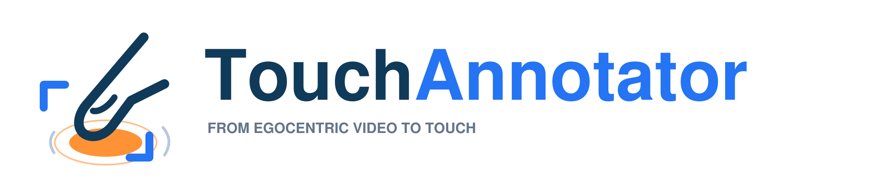
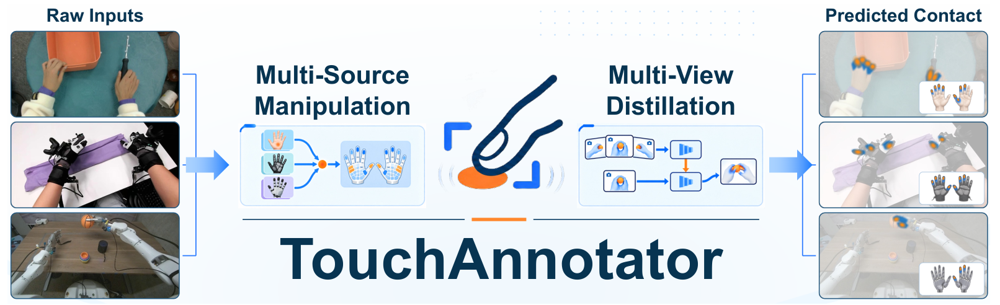
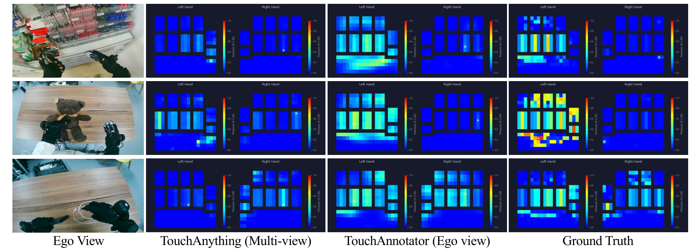
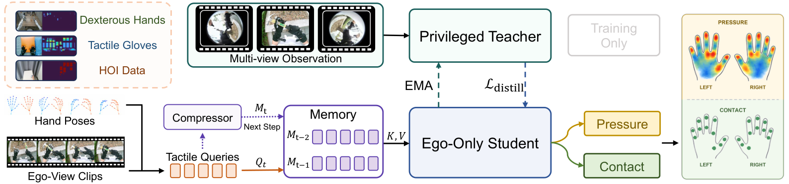
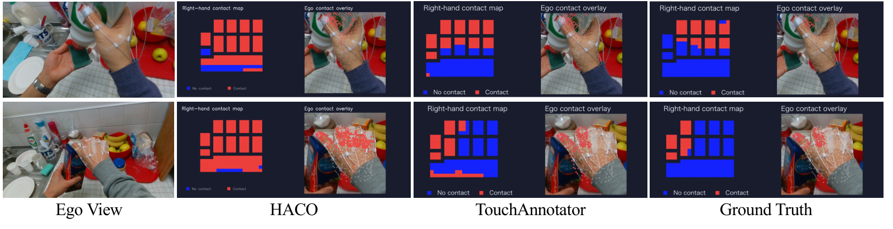
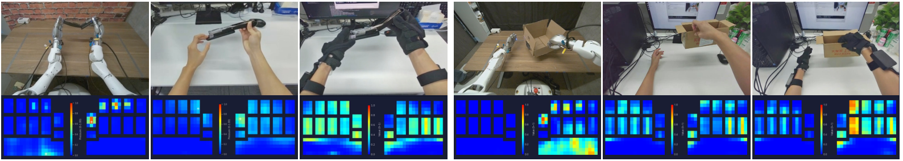
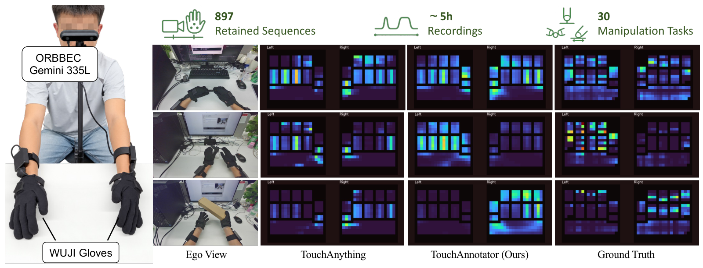

<div align="center">



<h3>Multi-Source Tactile Supervision<br>with Privileged-View Distillation</h3>

<p><strong>Turn a single egocentric video into bimanual tactile annotations.</strong></p>


<p>
<a href="https://github.com/RammusLeo/TouchAnnotator">💻 Code</a> &nbsp;·&nbsp;
<a href="https://huggingface.co/RammusLeo/TouchAnnotator">🤗 Model &amp; Weights</a> &nbsp;·&nbsp;
<a href="#quick-start">🚀 Quick Start</a> &nbsp;·&nbsp;
<a href="#method">🧠 Method</a> &nbsp;·&nbsp;
<a href="#results">🎨 Results</a> &nbsp;·&nbsp;
<a href="docs/INFERENCE.md">📖 Inference Guide</a> &nbsp;·&nbsp;
<a href="README.zh-CN.md">中文</a>
</p>



<sub>Concept illustration from the paper (Fig. 1). Heatmaps are schematic, not model predictions or sensor measurements.</sub>

</div>

## ✨ From seeing interaction to estimating touch

**TouchAnnotator** predicts a **21 × 21 relative-pressure field and contact-probability field for each hand**. A single RGB video supplies both the visual input and WiLoR-estimated hand poses. The model uses compact past-clip memory to add temporal context.

| 🤲 Bimanual fields | 🎥 Ego-only deployment | 🧩 Multi-source learning |
| :--- | :--- | :--- |
| Separate left/right pressure and contact predictions. | One video in; no wrist cameras or tactile sensors at inference. | Six training datasets spanning gloves, bare hands and dexterous robots. |

<div align="center">

<sub><b>Predicting touch from the ego view.</b> EgoTouch qualitative comparisons from Fig. 3; column labels retain the paper's input-view protocols.</sub>
</div>

<a id="quick-start"></a>

## 🚀 Quick start

**Linux · NVIDIA CUDA GPU · Python 3.10.** Run commands from the repository root. The tested runtime uses PyTorch 2.7.1, torchvision 0.22.1 and Transformers 5.3.0, with SDPA/BF16 inference. See [validation notes](VALIDATION.md) for hardware and installation coverage.

Clone the public inference repository:

```bash
git clone https://github.com/RammusLeo/TouchAnnotator.git
cd TouchAnnotator
```

A [source ZIP](https://huggingface.co/RammusLeo/TouchAnnotator/resolve/main/TouchAnnotator-source.zip) is also available. Model weights are downloaded separately in step 2.

### 1 · Set up the environment

```bash
conda create -n touchannotator python=3.10 -y
conda activate touchannotator
python -m pip install torch==2.7.1 torchvision==0.22.1 --index-url https://download.pytorch.org/whl/cu126
python -m pip install -r requirements.txt
conda install -c conda-forge ffmpeg -y
mkdir -p third_party
git clone https://github.com/rolpotamias/WiLoR.git third_party/WiLoR
git -C third_party/WiLoR checkout fcb911312a38fa8badd30d9656a167485d61b8f9
```

WiLoR is imported directly from its pinned checkout.

### 2 · Get the model assets

```bash
python scripts/download_assets.py
```

For an optional download mirror in mainland China:

```bash
HF_ENDPOINT=https://hf-mirror.com python scripts/download_assets.py
```

The downloader uses anonymous requests (`token=False`). [HF-Mirror usage](https://hf-mirror.com).

This single command downloads the **TouchAnnotator Full student**, its matching configuration and manifest, the official Qwen3.5-4B backbone, and WiLoR weights. It verifies the student checkpoint's SHA256. All downloads are public and require no Hugging Face login.

🤗 **[Model repository](https://huggingface.co/RammusLeo/TouchAnnotator)** · **[Checkpoint · 9.40 GB](https://huggingface.co/RammusLeo/TouchAnnotator/resolve/v1.0/model.pth)** · [Config](https://huggingface.co/RammusLeo/TouchAnnotator/resolve/v1.0/config.yaml) · [SHA256 manifest](https://huggingface.co/RammusLeo/TouchAnnotator/resolve/v1.0/manifest.json)

<details>
<summary>Download only TouchAnnotator when upstream models are already available</summary>

```bash
python scripts/download_assets.py --only-model
```

Equivalent Hugging Face CLI command:

```bash
hf download RammusLeo/TouchAnnotator model.pth config.yaml manifest.json --revision v1.0 --local-dir checkpoints/touchannotator
```

</details>

The downloader pins the model release to `v1.0`, Qwen to `851bf6e806efd8d0a36b00ddf55e13ccb7b8cd0a`, and WiLoR to `99fe3d7acff8104ecca1055df7467709506c2fa6`.


<details>
<summary>📁 Expected model directory layout</summary>

```text
checkpoints/
  touchannotator/
    model.pth                 # 9,401,275,903 bytes, student only
    config.yaml               # exact architecture + preprocessing
    manifest.json             # release SHA256
  Qwen3.5-4B/                 # official HF snapshot, including tokenizer and weights
third_party/WiLoR/
  wilor/
  pretrained_models/
    model_config.yaml         # from the pinned WiLoR checkout
    wilor_final.ckpt
    detector.pt
  mano_data/
    mano_mean_params.npz
```

</details>


> **Reproducible release:** `model.pth`, `config.yaml` and `manifest.json` are versioned together in [release v1.0](https://huggingface.co/RammusLeo/TouchAnnotator/tree/v1.0). Keep this set together.

The adapter can reconstruct MANO from buffers contained in the official WiLoR checkpoint, matching the existing evaluation adapter. If using a separately obtained MANO model, place `MANO_RIGHT.pkl` under `mano_data/` or pass `--mano-dir`. Upstream model terms still apply; see [third-party notices](THIRD_PARTY.md).

```bash
python scripts/check_assets.py
```

Use the Full student checkpoint with its matching configuration.

### 3 · Annotate your video

```bash
CUDA_VISIBLE_DEVICES=0 python demo.py \
  --video /path/to/bimanual_video.mp4 \
  --output-dir outputs/my_video
```

Start with a short smoke test:

```bash
CUDA_VISIBLE_DEVICES=0 python demo.py \
  --video /path/to/bimanual_video.mp4 \
  --max-frames 50 --output-dir outputs/smoke
```

`--max-frames` counts source frames, before sampling. Use `--no-video` to skip MP4 rendering. Output directories containing predictions are protected from accidental overwrite. WiLoR and TouchAnnotator run sequentially to release pose-estimator GPU memory before tactile inference.

<a id="method"></a>

## 🧠 How it works



*Training and deployment overview, reproduced from Fig. 2.*

1. **Unify tactile supervision.** A canonical bimanual field brings together measured glove pressure, geometry-derived contact and robot fingertip deformation, with source-aware validity masks.
2. **Learn from privileged views.** An EMA teacher observes ego and wrist video during training; the deployed student uses ego RGB and estimated pose.
3. **Carry temporal context.** Two previous clips are compressed into 16 tokens each. Separate heads predict relative pressure and contact probability.

The current eight-frame clip uses bidirectional reasoning. Memory is past-only across clips; this is an offline video annotator, not frame-online inference.

<a id="results"></a>

## 🎨 Qualitative results

### Bare-hand contact on FPHA



*Fig. 3, lower panels. Bare-hand contact estimates compared with geometry-derived reference labels.*

### Across hands and embodiments



*Fig. 5. Two sets of manipulation examples span dexterous robot hands, bare hands and tactile gloves. Colors are sensor-relative and do not establish a shared physical pressure scale.*

### Comparison with measured touch



*Fig. 4. Synchronized video and glove recordings with example predictions and measured maps. The collection contains 897 retained sequences across 30 tasks; the paper's shared quantitative comparison uses an 860-sequence subset.*

All images above are extracted from the author-provided manuscript. [Figure provenance and asset details](assets/README.md).

## 📦 What you get

| Output | Contents |
| :--- | :--- |
| `prediction.mp4` | Original video beside left/right pressure maps |
| `predictions.npz` | Pressure, contact probability, valid-cell masks, hand poses and timing |
| `wilor_poses.jsonl` | WiLoR joints, per-hand detection validity and gap-filling flags |
| `metadata.json` | Frame counts, pose coverage, precision and peak GPU memory |

```python
import numpy as np
prediction = np.load('outputs/my_video/predictions.npz')
pressure = prediction['pressure']               # (N, 2, 21, 21)
contact = prediction['contact_probability']     # (N, 2, 21, 21)
valid_cells = prediction['valid_cells']          # (2, 21, 21)
```

Hand order is **left, right**. Pressure is normalized and sensor-relative, not force in Newtons or pressure in kPa. Check pose validity for occluded or missed hands. [Full output schema, preprocessing and limitations →](docs/INFERENCE.md)

## 🔬 Release validation

**10 regression tests passed · 3 real-video smoke tests completed.** The bimanual test detected left/right hands in 21/25 and 20/25 sampled frames. Peak allocated GPU memory was approximately **10.26 GB on an H200**. These checks validate the inference path and output contracts; they do not reproduce every paper table or establish a minimum VRAM requirement.

The release contains the Full student, its matching inference config and a SHA256 manifest. Export preserves tensor values and dtypes while removing optimizer and teacher state. [Detailed validation record →](VALIDATION.md)

## 🤝 Acknowledgements

Built on the TouchAnything research codebase, [WiLoR](https://github.com/rolpotamias/WiLoR), and [Qwen3.5-4B](https://huggingface.co/Qwen/Qwen3.5-4B). The training formulation draws on EgoTouch, HumanTouch, HOI4D, TACO, OakInk2 and T-Rex.

Original project code retains the [MIT license](LICENSE). Third-party models and assets retain their own terms; see [third-party notices](THIRD_PARTY.md).
